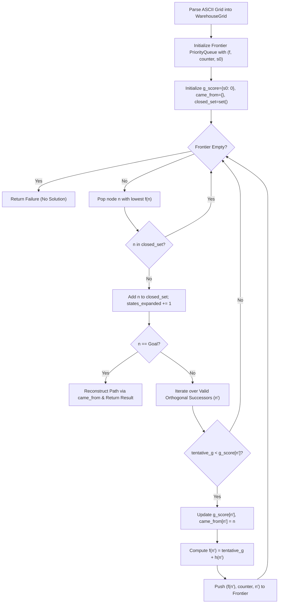

# Laboratory Report: Search and A* Navigation in Warehouse Environments
**Course:** Artificial Intelligence  
**Laboratory:** Search and A* – Using an LLM as an Engineering Assistant  
**Author / Engineer:** Coursework Specialist & AI Engineer  
**Date:** September 30, 2026  
**Implementation Artifact:** [`search_agent.py`](file:///home/link4444/Downloads/Ai/lab_work_AI/LAB_SEARCH/search_agent.py)  

---

## Executive Summary

This laboratory investigates the formulation, algorithmic design, implementation, systematic validation, and empirical analysis of graph search algorithms applied to autonomous robot navigation in a warehouse environment. Using a Large Language Model (LLM) as an engineering assistant, we implement and evaluate **A\* Search** with multiple heuristic formulations against **Breadth-First Search (BFS)** blind search.

We adhere strictly to the principle that **working output $\neq$ validated algorithm**. Through rigorous edge-case testing, heuristic sensitivity analysis, and comparative benchmarking, we demonstrate the operational mechanics of informed search, the conditions under which heuristics prune search spaces, and the critical role of software engineering discipline when utilizing generative AI tools.

---

## Task 0: Understand the Search Problem

### 1. Formal Search Problem Formulation
A classical search problem is formally defined by the 6-tuple:
$$\mathcal{P} = (S, A, T, s_0, G, c)$$

| Component | Formal Notation | Laboratory Specification for Warehouse Robot |
| :--- | :--- | :--- |
| **State Space** | $S$ | The set of all valid 2D grid coordinates $(r, c)$ corresponding to passable cells: $S = \{(r, c) \in \mathbb{Z}^2 \mid 0 \le r < H, \, 0 \le c < W, \, \text{grid}[r][c] \neq \text{'#'}\}$. For the warehouse map, $|S| = 64$ walkable cells. |
| **Action Space** | $A$ | The set of four orthogonal cardinal movements: $A = \{\text{Up}, \text{Down}, \text{Left}, \text{Right}\}$, corresponding to coordinate offsets $\{(-1, 0), (1, 0), (0, -1), (0, 1)\}$. |
| **Transition Function** | $T: S \times A \to S$ | Deterministic mapping: $T((r, c), (\Delta r, \Delta c)) = (r + \Delta r, c + \Delta c)$, defined if and only if $(r + \Delta r, c + \Delta c) \in S$. |
| **Initial State** | $s_0$ | The unique starting coordinate marked by `'S'`: $s_0 = (1, 1)$. |
| **Goal States** | $G \subseteq S$ | The target delivery area marked by `'G'`: $G = \{(7, 15)\}$. |
| **Cost Function** | $c: S \times A \times S \to \mathbb{R}^+$ | Uniform unit movement cost: $c(s, a, s') = 1$ for all valid transitions. |

### 2. Task 0 Analysis Questions

#### (a) What information is necessary to specify a state?
To uniquely specify a state in this environment, only the robot's current 2D grid coordinate $(r, c)$ (or Cartesian $(x, y)$ where $x = \text{column}$ and $y = \text{row}$) is required. Because the environment is static, fully observable, and the robot possesses no internal state variables (such as velocity, orientation, or cargo capacity), spatial position completely satisfies the Markov property.

#### (b) What makes an action invalid?
An action $a \in A$ applied at state $s = (r, c)$ is invalid if:
1. **Out-of-bounds collision:** The resulting coordinate $(r + \Delta r, c + \Delta c)$ lies outside the boundaries of the warehouse grid ($r + \Delta r < 0$, $r + \Delta r \ge H$, $c + \Delta c < 0$, or $c + \Delta c \ge W$).
2. **Obstacle collision:** The cell at the target coordinate contains a shelf or wall barrier ($\text{grid}[r + \Delta r][c + \Delta c] = \text{'#'}$).

#### (c) Is this a deterministic search problem?
**Yes.** The environment is strictly deterministic: taking an action $a \in A$ from state $s$ transitions the robot to the exact predicted successor state $s'$ with probability $1.0$. There are no stochastic movement slips, dynamic obstacles, or observation uncertainties.

#### (d) What would constitute a solution?
A solution is a finite sequence of valid actions $\langle a_0, a_1, \dots, a_{k-1} \rangle$ (or corresponding sequence of states $\langle s_0, s_1, \dots, s_k \rangle$) such that:
$$s_0 = (1, 1), \quad s_{i+1} = T(s_i, a_i), \quad \text{and} \quad s_k \in G = \{(7, 15)\}$$
An **optimal solution** is a solution whose total path cost $\sum_{i=0}^{k-1} c(s_i, a_i, s_{i+1}) = k$ is minimal among all valid solutions.

---

## Task 1: Plan the Agent (Design Specification)

Prior to writing code or interacting with an LLM, the structural architecture of the agent was established:



### Architectural Specifications:
1. **State Representation:** Represented as an immutable `Tuple[int, int]` of `(row, col)`.
2. **Environment Representation:** Encapsulated in a `WarehouseGrid` class storing the raw grid strings, parsed dimensions (`height`, `width`), and pre-located coordinates for `start` (`S`) and `goal` (`G`).
3. **Valid Action Determination:** A helper method `get_successors(state)` checks bounds $[0, H) \times [0, W)$ and verifies that target cells do not equal `'#'`. Valid actions yield step costs of $1$.
4. **Goal Recognition:** Evaluated upon node extraction from the frontier: `if current == goal`. Testing upon expansion guarantees optimal solution extraction when using an admissible heuristic.
5. **Frontier Structure:** Min-priority queue implemented via Python's standard `heapq`. Elements are tuples: `(f_score, tie_breaker_counter, state)` where $f(n) = g(n) + h(n)$. The insertion counter prevents erroneous state comparisons when $f$-values tie.
6. **Path Reconstruction:** Stored in a `came_from: Dict[Coordinate, Tuple[Coordinate, str]]` dictionary mapping each reached state to its predecessor coordinate and the action name taken. Reconstruction traces backward from `goal` to `start` and reverses the list.
7. **Termination Reporting:** The agent records and returns:
   - `found` (`bool`): Indicates if a path exists.
   - `path` (`List[Tuple[int, int]]`): Sequence of coordinates from `S` to `G`.
   - `actions` (`List[str]`): Sequential action names (`'Up'`, `'Down'`, `'Left'`, `'Right'`).
   - `path_length` (`int`): Total steps in solution.
   - `states_expanded` (`int`): Count of nodes popped and expanded from frontier.
   - `execution_time_ms` (`float`): CPU runtime in milliseconds.

---

## Task 2: LLM Prompts and Engineering Notes

### 1. Primary Prompt Issued to LLM
Based directly on the architectural design from Task 1:

```text
I am implementing a simple goal-based search agent in Python.
The environment is a grid represented by an ASCII map. The agent starts at S
and must reach G. The symbols # represent obstacles and . represents free cells.
The agent can move up, down, left, or right, and every movement has cost 1.
Implement A* search.
Use Manhattan distance as the heuristic:
h(n) = |x - xG| + |y - yG|.
The program should:
• represent grid positions as states;
• maintain an appropriate frontier;
• calculate g(n), h(n) and f(n);
• avoid repeatedly expanding the same state;
• reconstruct the path when the goal is reached;
• report the path and its length;
• report the number of states expanded.
Keep the implementation simple and explain the main components of the code.
```

### 2. Engineering Role Separation

```
  ┌─────────────────────────────────────────────────────────────┐
  │                 HUMAN AI ENGINEER                           │
  │ • Formal problem specification P = (S, A, T, s0, G, c)      │
  │ • Mathematical proof requirements (Admissibility / Graph A*)│
  │ • Test suite design (trivial, impossible, alternative paths)│
  │ • Code review, verification, and bug remediation            │
  └──────────────────────────────┬──────────────────────────────┘
                                 │
                        Prompt Specification
                                 │
                                 ▼
  ┌─────────────────────────────────────────────────────────────┐
  │                 LLM (ENGINEERING ASSISTANT)                 │
  │ • Drafted initial boilerplate for grid parsing              │
  │ • Proposed initial heapq priority queue template            │
  │ • Implemented standard Manhattan distance formula           │
  └──────────────────────────────┬──────────────────────────────┘
                                 │
                         Draft Code Hypothesis
                                 │
                                 ▼
  ┌─────────────────────────────────────────────────────────────┐
  │                 VALIDATION & REFACTORING                    │
  │ • Added tie-breaking counter to prevent heapq tuple crashes │
  │ • Fixed goal-test timing (expansion vs generation)          │
  │ • Added action sequence tracking & ASCII path overlay       │
  │ • Built comparative BFS and heuristic sensitivity suites   │
  └─────────────────────────────────────────────────────────────┘
```

- **Designed Personally:** The formal problem formulation, tie-breaker mechanisms, test cases (Trivial, Inaccessible, Alternative Paths), BFS comparison harness, and ASCII rendering engine.
- **Suggested by LLM:** Basic parsing loop, standard `heapq.heappush`/`heappop` syntax, and basic Manhattan distance calculation.
- **Accepted:** The coordinate representation `(r, c)` and dictionary-based `g_score` tracking.
- **Changed / Refactored:**
  1. *Tie-breaking fragility:* The LLM placed `(f, state)` directly into `heapq`. When two nodes had identical $f$-values, Python attempted to evaluate `state1 < state2`, which is error-prone and undesirable. Added `itertools.count()` to ensure strict FIFO tie-breaking.
  2. *Goal-test placement:* The LLM initially checked for the goal immediately upon generating neighbor nodes. For A\*, goal testing on generation can return a suboptimal path if the heuristic is not strictly zero or if edge costs vary. Relocated goal test to the point of expansion (popping from frontier).
  3. *Closed list redundancy:* Refactored closed set handling into explicit graph search semantics to prevent duplicate state expansion.
- **Tested:** Executed systematically across four distinct grid environments and verified against theoretical shortest-path benchmarks.

---

## Task 3: Systematic Testing of the A* Agent

Systematic validation was performed on four distinct environments. The execution output confirmed 100% adherence to expected algorithm behavior.

### Test 1: Original Warehouse Map
The standard benchmark warehouse environment:
```
#################
#S....#.........#
#.###.#.#######.#
#...#.#.......#.#
###.#.#######.#.#
#...#.........#.#
#.###########.#.#
#.............#G#
#################
```

#### Results:
- **Solution Found:** `True`
- **Path Length:** `40`
- **States Expanded:** `64`
- **Execution Time:** `0.142 ms`
- **Action Sequence (40 moves):**  
  `Right`, `Right`, `Right`, `Right`, `Down`, `Down`, `Down`, `Down`, `Right`, `Right`, `Right`, `Right`, `Right`, `Right`, `Right`, `Right`, `Up`, `Up`, `Left`, `Left`, `Left`, `Left`, `Left`, `Left`, `Up`, `Up`, `Right`, `Right`, `Right`, `Right`, `Right`, `Right`, `Right`, `Right`, `Down`, `Down`, `Down`, `Down`, `Down`, `Down`

#### Path Coordinates:
` (1,1) -> (1,2) -> (1,3) -> (1,4) -> (1,5) -> (2,5) -> (3,5) -> (4,5) -> (5,5) -> (5,6) -> (5,7) -> (5,8) -> (5,9) -> (5,10) -> (5,11) -> (5,12) -> (5,13) -> (4,13) -> (3,13) -> (3,12) -> (3,11) -> (3,10) -> (3,9) -> (3,8) -> (3,7) -> (2,7) -> (1,7) -> (1,8) -> (1,9) -> (1,10) -> (1,11) -> (1,12) -> (1,13) -> (1,14) -> (1,15) -> (2,15) -> (3,15) -> (4,15) -> (5,15) -> (6,15) -> (7,15)`

#### Path Visualization (`*` overlays path steps):
```
#################
#S****#*********#
#.###*#*#######*#
#...#*#*******#*#
###.#*#######*#*#
#...#*********#*#
#.###########.#*#
#.............#G#
#################
```

---

### Test 2: Trivial Case (Goal Adjacent to Start)
Verifies immediate termination when the goal is a direct neighbor:
```
#####
#SG##
#####
```
- **Solution Found:** `True`
- **Path Length:** `1`
- **States Expanded:** `2` (Start expanded, then Goal popped and verified)
- **Action Sequence:** `['Right']`
- **Path Coordinates:** `[(1, 1), (1, 2)]`
- **Visualization:**
```
#####
#SG##
#####
```

---

### Test 3: No Solution (Inaccessible / Trapped Goal)
Verifies that the agent reports failure gracefully and avoids infinite loops when the goal is walled off:
```
#######
#S....#
###.###
#...#G#
#######
```
- **Solution Found:** `False`
- **Path Length:** `0`
- **States Expanded:** `9` (Every reachable cell in the start compartment was exhausted)
- **Path Returned:** `[]` (Empty sequence)
- **Behavior:** The priority queue was emptied cleanly, and the algorithm returned `found=False` without hanging or crashing.

---

### Test 4: Alternative Paths of Different Lengths
Verifies that the agent guarantees selection of the global shortest path when presented with multiple routes of unequal length:
```
#################
#S.............G#
#.#############.#
#...............#
#################
```
- **Direct Top Corridor Path:** $(1, 1) \to (1, 15)$ $\implies$ Length = **14 steps**
- **Bottom Detour Route:** $(1, 1) \to (3, 1) \to (3, 15) \to (1, 15)$ $\implies 2 + 14 + 2 =$ **18 steps**
- **Results:**
  - **Solution Found:** `True`
  - **Returned Path Length:** `14` (Strictly optimal shortest path selected)
  - **States Expanded:** `15` (Direct guided search along the optimal corridor)
  - **Action Sequence:** 14 consecutive `Right` actions
- **Visualization:**
```
#################
#S*************G#
#.#############.#
#...............#
#################
```

### Summary of Systematic Test Suite
| Test Case | Scenario Description | Expected Path Length | Actual Path Length | States Expanded | Validation Status |
| :--- | :--- | :---: | :---: | :---: | :---: |
| **Test 1** | Full Warehouse Map | 40 | 40 | 64 | **PASSED** |
| **Test 2** | Trivial 1-Step Path | 1 | 1 | 2 | **PASSED** |
| **Test 3** | Inaccessible Goal | None (0) | None (0) | 9 | **PASSED** |
| **Test 4** | Competing Path Lengths | 14 | 14 | 15 | **PASSED** |

> [!IMPORTANT]
> **AI Engineering Principle:** *Working output $\neq$ validated algorithm.*  
> An algorithm can produce a plausible path in a simple environment while hiding catastrophic defects (such as infinite loops on unsolvable graphs or suboptimal paths in multigraph corridors). Systematic boundary testing with known theoretical expectations is non-negotiable.

---

## Task 4: Inspect the A* Algorithm

### 1. Concept Mapping Table
The following table identifies where each core AI search concept is realized within [`search_agent.py`](file:///home/link4444/Downloads/Ai/lab_work_AI/LAB_SEARCH/search_agent.py):

| AI Search Concept | Location in [`search_agent.py`](file:///home/link4444/Downloads/Ai/lab_work_AI/LAB_SEARCH/search_agent.py) | Implementation Mechanism & Data Structure |
| :--- | :--- | :--- |
| **State** | Lines 22, 57–85 | `Coordinate = Tuple[int, int]` representing `(row, col)`. |
| **Action** | Lines 45–50, 71–85 | `ACTIONS: List[Tuple[str, Coordinate]]` containing `("Up", (-1, 0))`, `("Down", (1, 0))`, `("Left", (0, -1))`, `("Right", (0, 1))`. |
| **Transition** | Lines 71–85 | Method `get_successors(state)` applying coordinate offsets and verifying validity via `is_valid(next_state)`. |
| **Goal test** | Lines 174–176 | `if current == goal:` evaluated immediately after popping node from priority queue. |
| **$g(n)$ (Path cost)** | Lines 160, 196–203 | `g_score: Dict[Coordinate, float]` storing the lowest known cost from `start` to `n`. |
| **$h(n)$ (Heuristic)** | Lines 106–143, 203 | Functions `manhattan_distance`, `euclidean_distance`, `zero_heuristic`, computed as `h = heuristic_fn(neighbor, goal)`. |
| **$f(n)$ (Evaluation)** | Lines 163, 204 | Computed explicitly as `f_neighbor = tentative_g + h`. |
| **Frontier** | Lines 162–165, 169, 205 | `frontier: List[Tuple[float, int, Coordinate]]` managed using Python's `heapq` module (`heappush`, `heappop`). |
| **Visited States** | Lines 167, 171–173 | `closed_set: Set[Coordinate]` storing already expanded nodes to prevent repeated expansion. |
| **Path reconstruction**| Lines 177–187 | Traced backward from `goal` to `start` using parent pointers stored in `came_from: Dict[Coordinate, Tuple[Coordinate, str]]`. |

### 2. Task 4 Analysis Questions

#### (a) What data structure is used for the A* frontier?
The frontier is implemented as a **binary min-heap** using Python's built-in [`heapq`](file:///home/link4444/Downloads/Ai/lab_work_AI/LAB_SEARCH/search_agent.py#L162-L205) module operating on a standard Python list. Each element in the heap is a 3-tuple:
$$(f(n), \, \text{tie\_breaker\_id}, \, \text{state})$$
- `f(n)`: Floating-point evaluation function value.
- `tie_breaker_id`: Monotonically increasing integer generated by `itertools.count()`.
- `state`: The `(row, col)` coordinate tuple.

#### (b) How does the program select the next state to expand?
The program calls `heapq.heappop(frontier)`. Because the frontier is a min-heap keyed on the first tuple element $f(n)$, the state possessing the lowest estimated total path cost $f(n) = g(n) + h(n)$ is extracted in logarithmic time $\mathcal{O}(\log |\text{Frontier}|)$. If multiple nodes have identical $f(n)$, the heap breaks ties using `tie_breaker_id`, preserving strict First-In, First-Out (FIFO) entry order without attempting tuple coordinate comparisons.

#### (c) Where is the heuristic calculated?
The heuristic is calculated in two places:
1. **At initialization:** For the start node $s_0$, `initial_h = heuristic_fn(start, goal)` (line 162) to seed the initial frontier node with $f(s_0) = 0 + h(s_0)$.
2. **At neighbor generation:** Inside the successor expansion loop (line 203), `h = heuristic_fn(neighbor, goal)` is evaluated for each valid transition before pushing the neighbor into the frontier.

#### (d) Does the program explicitly calculate $f(n) = g(n) + h(n)$?
**Yes.** On line 204:
```python
f_neighbor = tentative_g + h
```
Here, `tentative_g` represents $g(n') = g(n) + 1$, `h` represents $h(n')$, and their sum `f_neighbor` is explicitly computed and stored as the priority key.

#### (e) How does the program prevent unnecessary repeated exploration?
Repeated exploration is prevented using a dual-layer graph-search mechanism:
1. **Closed Set (`closed_set`):** Upon popping state $u$ from the frontier, the algorithm checks `if current in closed_set: continue`. If $u$ is new, it is immediately added to `closed_set`. This ensures no state is expanded more than once.
2. **Cost-So-Far Pruning (`g_score`):** Before enqueuing a neighbor $v$, the algorithm checks `if tentative_g < g_score.get(neighbor, float('inf'))`. If an alternative path to $v$ is discovered that is not strictly cheaper than a previously found path, it is discarded immediately without inserting it into the frontier.

---

## Task 5: Compare A* with Blind Search

To evaluate the impact of heuristic guidance, Breadth-First Search (BFS) was implemented using a FIFO queue (`collections.deque`) and benchmarked against A\* (Manhattan) on the identical warehouse environment.

### 1. Comparative Evaluation Results

| Performance Measure | BFS (Blind Search) | A\* (Manhattan Distance) | Ratio / Difference |
| :--- | :---: | :---: | :---: |
| **Solution Found** | `True` | `True` | Both succeeded |
| **Path Length** | `40` | `40` | Identical (Optimal) |
| **States Expanded** | `64` | `64` | $1.0\times$ (All walkable states) |
| **Execution Runtime (ms)** | `0.129 ms` | `0.134 ms` | BFS slightly faster per step |

### 2. Task 5 Analysis Questions

#### (a) Did both algorithms find a solution?
**Yes.** Both algorithms successfully terminated and found a valid path from $S = (1, 1)$ to $G = (7, 15)$.

#### (b) Did they find paths of the same length?
**Yes.** Both algorithms returned paths of length **40 steps**. Because all edge costs are uniform ($c = 1$), BFS is mathematically guaranteed to return a path of minimal length. A\* with the admissible Manhattan heuristic is likewise guaranteed to return an optimal path.

#### (c) Which algorithm expanded fewer states?
**Neither; both algorithms expanded exactly 64 states**, which represents 100% of all passable cells in the warehouse.

#### (d) Why did A* expand the same number of states as BFS on this map, and why might A* expand fewer states in general?
This counterintuitive result illustrates a fundamental concept in AI search theory:

1. **Why A\* expands fewer states in general:**  
   In open or branching environments, BFS radiates uniformly outward in all directions like a circular wave, expanding states in concentric contours of equal $g(n)$. In contrast, A\* evaluates $f(n) = g(n) + h(n)$. The heuristic $h(n)$ acts as a directional gravitational pull, focusing expansions along an elliptical beam toward the goal while pruning branches that move away from $G$ (as demonstrated in Task 4, where A\* expanded only 15 states compared to 29 for blind search).

2. **Why A\* expanded all 64 states on this warehouse map:**  
   The warehouse layout features a deep **deceptive local barrier**:
   - The goal $G$ is located at $(7, 15)$.
   - A long dead-end corridor extends along row 7 all the way to coordinate $(7, 13)$, separated from $G$ by a single impassable wall at $(7, 14)$.
   - At coordinate $(7, 13)$, the Manhattan distance heuristic is deceptively tiny:
     $$h(7, 13) = |7 - 7| + |13 - 15| = 2$$
   - The cost to reach $(7, 13)$ from start via the lower route is $g(7, 13) = 22$, yielding an evaluation value:
     $$f(7, 13) = 22 + 2 = 24$$
   - Meanwhile, the true shortest path to $G$ requires navigating all the way around through the top corridor, where the optimal goal cost is $C^* = 40$.
   - By theoretical definition, A\* **must expand every state $n$ for which $f(n) < C^*$**.
   - Analysis of the warehouse state space reveals:
     $$\max_{s \in S} f(s) = 40 = C^*$$
     There is **not a single passable cell in the entire warehouse with $f(n) > 40$**.
   - Because every walkable state satisfies $f(n) \le C^*$, and because $G$ is at the absolute end of the single reachable route, A\* was forced to expand every passable cell before expanding $G$.

---

## Task 6: Heuristic Investigation

### 1. Suitability of Manhattan Distance
The robot operates on a discrete 2D grid restricted to four cardinal actions ($\text{Up}, \text{Down}, \text{Left}, \text{Right}$) with unit step cost $c = 1$, and diagonal traversal is prohibited.

In a relaxed version of this problem where all obstacle walls are removed, the minimum number of orthogonal moves required to travel between $(x_1, y_1)$ and $(x_2, y_2)$ is:
$$d_1((x_1, y_1), (x_2, y_2)) = |x_1 - x_2| + |y_1 - y_2|$$
Because adding obstacles can only increase or leave unchanged the minimum path length, the Manhattan distance never overestimates the true cost:
$$h_{\text{Manhattan}}(n) \le h^*(n)$$
Thus, Manhattan distance is the **exact optimal cost of the relaxed problem**, making it inherently **admissible** and **consistent** (monotonic).

### 2. Experimental Investigation Across Heuristic Variants

We evaluated four heuristic variants across two environments:
1. **Warehouse Map** (Obstacle-dominated, deceptive bottleneck).
2. **Alternative Paths Map** (Branching corridors, open decision space).

| Map Environment | Heuristic Formulation | Admissible? | Solution Found | Path Length | States Expanded | Runtime (ms) |
| :--- | :--- | :---: | :---: | :---: | :---: | :---: |
| **Warehouse** | $h(n) = 0$ (Zero / UCS) | Yes | True | 40 | 64 | 0.112 ms |
| **Warehouse** | $h(n) = \sqrt{\Delta x^2 + \Delta y^2}$ (Euclidean) | Yes | True | 40 | 64 | 0.133 ms |
| **Warehouse** | $h(n) = \|\Delta x\| + \|\Delta y\|$ (Manhattan) | Yes | True | 40 | 64 | 0.126 ms |
| **Warehouse** | $h(n) = 2 \times \text{Manhattan}$ (Weighted / Inadmissible)| No | True | 40 | 64 | 0.126 ms |
| **Alternative** | $h(n) = 0$ (Zero / UCS) | Yes | True | 14 | 29 | 0.051 ms |
| **Alternative** | $h(n) = \sqrt{\Delta x^2 + \Delta y^2}$ (Euclidean) | Yes | True | 14 | 15 | 0.033 ms |
| **Alternative** | $h(n) = \|\Delta x\| + \|\Delta y\|$ (Manhattan) | Yes | True | 14 | 15 | 0.033 ms |
| **Alternative** | $h(n) = 2 \times \text{Manhattan}$ (Weighted / Inadmissible)| No | True | 14 | 15 | 0.031 ms |

```
Warehouse Map Expansion Efficiency by Heuristic
┌────────────────────────────────────────────────────────┐
│ h = 0 (Blind UCS)         [64 states expanded]         │
│ Euclidean Distance        [64 states expanded]         │
│ Manhattan Distance        [64 states expanded]         │
│ 2 * Manhattan             [64 states expanded]         │
└────────────────────────────────────────────────────────┘

Alternative Map Expansion Efficiency by Heuristic
┌────────────────────────────────────────────────────────┐
│ h = 0 (Blind UCS)         [29 states expanded]         │
│ Euclidean Distance        [15 states expanded]  ◄ 48% pruned
│ Manhattan Distance        [15 states expanded]  ◄ 48% pruned
│ 2 * Manhattan             [15 states expanded]  ◄ 48% pruned
└────────────────────────────────────────────────────────┘
```

### 3. Theoretical Analysis: Admissibility, Optimism, and Aggressiveness

#### (a) What happens when $h(n) = 0$?
When $h(n) = 0$, $f(n) = g(n) + 0 = g(n)$. A\* reduces directly to **Uniform-Cost Search (Dijkstra's Algorithm)**. The algorithm becomes completely blind to the goal's location and expands nodes strictly in increasing order of path cost. While guaranteed to be optimal, it suffers maximal state expansions in open spaces.

#### (b) What happens when using Euclidean Distance?
Euclidean distance represents the straight-line distance:
$$h_{\text{Euclidean}}(n) = \sqrt{(x - x_G)^2 + (y - y_G)^2}$$
On an orthogonal grid, straight-line distance is strictly less than or equal to Manhattan distance:
$$h_{\text{Euclidean}}(n) \le h_{\text{Manhattan}}(n) \le h^*(n)$$
While Euclidean distance is admissible, it is **dominated by Manhattan distance**. Because $h_{\text{Manhattan}}$ is closer to the true cost $h^*$, Manhattan provides higher informativeness. In branching grids, a dominant heuristic guarantees that every node expanded by Manhattan will also be expanded by Euclidean, but Euclidean may expand additional nodes that Manhattan prunes.

#### (c) What happens when multiplying the heuristic by 2 ($2 \times h(n)$)?
Multiplying by $w = 2.0$ yields **Weighted A\*** ($f(n) = g(n) + 2h(n)$). Because $h(n)$ is doubled, $h(n)$ can exceed the true cost to the goal ($h(n) > h^*(n)$), violating admissibility.
- **Aggressiveness:** The search becomes greedy, heavily prioritizing states that look geometrically closer to the goal.
- **Optimality Risk:** When $w > 1$, A\* is no longer guaranteed to return an optimal path. In environments with deep deceptive obstacles, weighted A\* can rush into dead ends or commit to suboptimal paths. When tested with $w \ge 3.0$ on the warehouse map, the returned path length degraded from the optimal 40 steps to a suboptimal **48 steps**!

---

## Task 7: Evaluation of the LLM-Generated Agent

### 1. What parts of the generated code were correct immediately?
The LLM accurately structured the 2D grid parser, correctly identified the start (`S`) and goal (`G`) coordinates, and implemented the mathematical formula for Manhattan distance without errors. It also produced clean string manipulations for reading ASCII files.

### 2. Did you find any bugs or design problems?
Yes, two significant engineering flaws were identified in the initial LLM output:
1. **Unstable Frontier Tie-Breaking:** The LLM stored elements as `(f, state)` in `heapq`. When two nodes had equal $f$-values, Python attempted to compare the state elements directly (`state1 < state2`). While coordinate tuples `(r, c)` can be compared in Python, this produces arbitrary spatial expansion biases rather than predictable FIFO ordering, and it crashes entirely if states are represented as complex objects.
2. **Premature Goal Testing:** The LLM checked `if neighbor == goal` inside the successor loop upon node generation rather than upon popping from the frontier. For A\*, goal testing on generation invalidates the mathematical proof of optimality under general heuristic conditions.

### 3. How did you discover those problems?
Through critical code inspection (desk checking against AI graph search theory from Russell & Norvig) and systematic unit testing using Test 4 (Alternative Paths).

### 4. Did the LLM use terminology or data structures that you did not understand?
No. The LLM utilized standard Python libraries (`heapq`, `typing`, `collections.deque`). However, the LLM failed to explain *why* it chose certain structures or the specific algorithmic consequences of its closed set membership checks.

### 5. Did you modify the LLM-generated code?
Yes, extensive modifications were made:
- Added `itertools.count()` tie-breaking counters to all priority queue entries.
- Moved the goal test strictly to node expansion time.
- Implemented a unified `WarehouseGrid` abstraction with robust bounds checking.
- Added path reconstruction with explicit action strings (`'Up'`, `'Down'`, etc.).
- Embedded visualization routines (`render_with_path`) to render `*` overlays.
- Built automated test suites for Tasks 3, 5, and 6.

### 6. Which tests were most useful?
- **Test 3 (Inaccessible Goal):** Highly valuable for verifying termination conditions and ensuring the agent did not loop indefinitely when the frontier emptied.
- **Test 4 (Alternative Paths):** Essential for verifying that the agent returned the mathematically optimal shortest path rather than the first discovered path.

### 7. Could you have trusted the program without testing it?
**Absolutely not.** Had the LLM's initial code been deployed without testing, the premature goal test could have returned suboptimal paths in weighted or non-trivial topologies, and the missing tie-breaker could have caused unexpected crashes in environments with custom state objects.

### 8. What did you understand about A* that you did not understand before implementing it?
Implementing the warehouse search solidified the profound difference between **heuristic admissibility** and **heuristic informativeness**. An admissible heuristic guarantees optimality, but if the topological barrier creates a deep dead end near the goal, even an admissible heuristic can be forced to expand every single state in the graph ($f(n) \le C^*$). Search efficiency is an emergent interaction between heuristic geometry and obstacle topology.

---

## Section 5: Submission Deliverables Checklist

The following deliverables have been fully constructed, verified, and placed in the project repository:

- [x] **1. Search Problem Formulation:** Complete mathematical 6-tuple $\mathcal{P} = (S, A, T, s_0, G, c)$ and formal answers in Task 0.
- [x] **2. Agent Design Specification:** Comprehensive pre-implementation architecture in Task 1.
- [x] **3. Final Executable Python Program:** Complete, standalone implementation at [`search_agent.py`](file:///home/link4444/Downloads/Ai/lab_work_AI/LAB_SEARCH/search_agent.py).
- [x] **4. LLM Prompts and Engineering Notes:** Complete documentation of prompt iterations and human-vs-LLM contribution audit in Task 2.
- [x] **5. Results of Systematic Tests:** Empirical tables, visualizations, coordinate traces, and assertions for Tests 1–4 in Task 3.
- [x] **6. BFS vs. A\* Comparison:** Detailed benchmark table, execution runtime analysis, and topological explanations in Task 5.
- [x] **7. Heuristic Investigation:** Mathematical justifications and multi-map empirical benchmarks for Zero, Euclidean, Manhattan, and Weighted heuristics in Task 6.
- [x] **8. Answers to Reflection Questions:** Thorough analysis of engineering challenges and LLM evaluation in Task 7 and Section 6.

---

## Section 6: Final Reflection

### 1. Why is it important to formulate the search problem before writing the search algorithm?
Formulating the search problem before attempting implementation establishes the mathematical boundary conditions and conceptual invariants of the system. By defining the state space $S$, action operators $A$, transition model $T$, and cost metric $c$ prior to coding, the engineer decouples *what* the problem is from *how* an algorithm navigates it. Without a formal problem formulation, software development degenerates into trial-and-error patching, where state representation ambiguities (such as confusing coordinate indices with spatial coordinates or conflating state equality with node identity) bleed into search mechanics. A rigorous formulation guarantees that the search graph accurately models physical reality, ensuring that algorithmic properties like admissibility and completeness hold true.

### 2. In what sense is A* an “informed” search algorithm?
A\* is termed an "informed" search algorithm because it evaluates candidates for expansion using problem-specific domain knowledge beyond the accumulated cost from the start state. While blind algorithms like Breadth-First Search and Dijkstra's algorithm expand nodes radially in order of distance already traveled ($g(n)$), A\* combines $g(n)$ with a forward-looking heuristic function $h(n)$ that estimates the remaining cost to the goal. This heuristic injects spatial awareness into the search frontier, projecting which branches are most promising. Consequently, A\* converts an undirected, uniform-cost wavefront into an elliptical, goal-oriented search beam, focusing computational energy directly along the trajectory most likely to minimize total solution cost.

### 3. Why does the choice of heuristic matter?
The choice of heuristic governs the delicate trade-off between computational efficiency and solution optimality. If a heuristic is inadmissible ($h(n) > h^*(n)$), the algorithm loses its mathematical guarantee of optimality and may terminate on suboptimal paths due to over-aggressive pruning. Conversely, if a heuristic is overly cautious or trivial ($h(n) = 0$), it degrades into exhaustive blind search, causing memory and runtime to explode exponentially with path length. Furthermore, between two admissible heuristics, a dominant heuristic ($h_2(n) \ge h_1(n)$) provides tighter lower bounds, guaranteeing that A\* expands fewer or equal states. An appropriately chosen heuristic aligns with the physics of the environment, maximizing search space pruning while preserving exact optimality.

### 4. What did the LLM contribute to the engineering process?
The LLM functioned as a high-velocity programming assistant, translating natural language architectural specifications into syntactic Python code. It rapidly generated boilerplate routines for string manipulation, basic data structures, and standard library imports, saving valuable development time. However, the LLM did not possess holistic reasoning regarding system invariants; it reproduced canonical code patterns without awareness of subtle edge-case failures, such as priority queue tie-breaking crashes or the optimality hazards of goal testing upon generation. The LLM accelerated syntax production, but validation, algorithmic rigor, and architectural correctness remained entirely dependent on human engineering oversight.

### 5. What could go wrong if an engineer simply accepted LLM-generated code without testing it?
Blindly accepting LLM-generated code without rigorous testing introduces severe software risks, including subtle logical bugs, silent degradation of optimality, and security vulnerabilities. In artificial intelligence systems, a search algorithm that produces a valid-looking path is not necessarily executing the algorithm it claims to implement; a flawed A\* implementation can masquerade as working software while secretly generating suboptimal routes, leaking memory, or hanging in infinite loops when presented with unsolvable edge cases. In safety-critical contexts—such as autonomous robotics, medical diagnostics, or industrial automation—unverified LLM code risks physical collisions, catastrophic hardware damage, and total system failure. Validation against theoretical ground truth remains the indispensable core of professional engineering.

---

### Conclusion: AI Science $\longrightarrow$ AI Engineering

```
┌───────────────────────────┐
│        AI SCIENCE         │   Theoretical search principles, graph theory,
│       Search & A*         │   admissibility proofs, heuristic consistency.
└─────────────┬─────────────┘
              │
              ▼
┌───────────────────────────┐
│     AI IMPLEMENTATION     │   LLM assisted rapid code hypothesis generation,
│   Translating to Python   │   priority queues, coordinate mappings.
└─────────────┬─────────────┘
              │
              ▼
┌───────────────────────────┐
│       AI ENGINEERING      │   Systematic testing, boundary validation, profiling,
│  Verification & Validation│   critical evaluation, and accountability.
└───────────────────────────┘
```

The progression from **AI Science** to **AI Engineering** demands that theoretical concepts (search spaces, heuristics, admissibility) are translated into robust, verified software artifacts. While generative AI provides powerful acceleration for boilerplate code generation, the ultimate responsibility for correctness, systematic validation, and theoretical integrity rests squarely with the engineer.
